<h1 align="center">Botkit</h1>

<p align="center">
  <b>Let AI coding agents build real tickets while a person stays in charge of what ships.</b><br>
  Claude Code builds. My tests decide. Codex reviews. I commit.<br>
  <sub>A safety harness and an evaluation harness for AI coding tools, written from scratch in Python.</sub>
</p>

<p align="center">
  <a href="https://github.com/kenecu1/botkit/actions/workflows/ci.yml"></a>
  
  
  
</p>

<p align="center">
  <a href="#the-problem">Problem</a> ·
  <a href="#how-it-works">How it works</a> ·
  <a href="#design-decisions">Design decisions</a> ·
  <a href="#what-this-project-demonstrates">Skills</a> ·
  <a href="#the-experiment">Experiment</a> ·
  <a href="#status">Status</a> ·
  <a href="docs/design.md">Full design</a>
</p>

<p align="center">
  <picture>
    <source media="(prefers-color-scheme: dark)" srcset="docs/assets/pipeline-dark.svg">
    <source media="(prefers-color-scheme: light)" srcset="docs/assets/pipeline-light.svg">
    
  </picture>
</p>

> [!NOTE]
> **Where this stands.** The design is finished and the repo skeleton and CI are in place. The parts are being built now, so Botkit does not run end to end yet and the experiment has no results. The [status](#status) section is kept current.

## In 30 seconds

Botkit is a small Python tool for running AI coding agents safely on real projects.

1. I write a short brief with examples.
2. Claude Code builds the change inside a throwaway clone that cannot push.
3. My tests decide pass or fail. The agent's own test runs never count.
4. A second model from a different vendor, OpenAI Codex, reviews the change as advice only.
5. Every step is recorded. I explain the change, then commit and push by hand.

It is also the harness for a study in my Intro to AI course (CSE 4705, UConn): of the bugs that slip past tests, how many does an AI reviewer catch, and at what false alarm cost?

## The problem

AI agents write code quickly, but three things go wrong when they run unattended.

1. They commit or push work that no person has read.
2. They write the tests that grade their own code, so a green run proves little.
3. Afterwards, nobody can say exactly what the agent did.

Botkit answers each one with a mechanism in code, not with a polite instruction in a prompt.

| Risk | What Botkit does about it |
|---|---|
| An agent commits or pushes | The agent works in a throwaway clone that has no remote. A git snapshot taken before and after the run catches any commit, even one that was later reset away. The only way back into the real repo is a patch that I apply myself |
| An agent grades its own work | Acceptance tests come from examples I write and approve before the run. Botkit restores every existing test file from the base commit and runs the tests itself |
| A reviewer model blocks good code or rubber stamps bad code | The review is advice only. It is stored next to the outcome as a separate field and cannot change it |
| No audit trail | Every run writes one folder: inputs, commands, raw model output, the patch, test output, the review and the verdict |

## How it works

| Step | Who | What happens |
|---|---|---|
| Brief | Me | A few lines: the goal, three to five examples, and the files that may change |
| Spec and tests | Claude drafts, I approve | One failing test per example. I read every test, then commit them |
| Build | Claude Code | Runs headless inside a fresh clone with its remote removed |
| Guard | Botkit | Compares git state before and after. Any commit or moved ref stops the run |
| Test | Botkit | Restores my tests from the base commit and runs them. They alone decide the outcome |
| Review | Codex | Reads the brief, the spec and the patch. Returns findings as JSON, with evidence for each |
| Merge | Me | I write my own explanation of the change, apply the patch, then commit and push |

A run ends in exactly one of four outcomes.

| Outcome | Meaning |
|---|---|
| `PASS` | Git state is clean and my tests are green |
| `FAIL` | Git state is clean, tests are red or no acceptance test ran |
| `VIOLATION` | The agent committed, moved a ref, changed git config, or touched the real repo |
| `ERROR` | A tool crashed, timed out, hit a usage limit, or changed nothing |

## Design decisions

These are the choices I would walk through in an interview. The complete design is in [`docs/design.md`](docs/design.md) and the dated log is in [`DECISIONS.md`](DECISIONS.md).

1. **Isolation by construction, not by instruction.** A git worktree shares refs and remotes with the real repo, so an agent commit lands in the real repository. A separate clone with its remote removed makes a push impossible and keeps commits out of my history. My first design used worktrees, and a review of it showed the gap.
2. **Detection as a pure function.** The guard compares two snapshots (HEAD, every ref, reflog length, a hash of the git config) and returns a list of violations. No state, easy to test, easy to explain.
3. **Tests decide, and the tests are protected.** The agent can read the tests but cannot change the verdict by editing them, because Botkit restores them before the deciding run.
4. **Limits expressed as data shapes.** The reviewer cannot block a merge because its output has no path to the outcome field. The rule lives in the structure, not in a comment.
5. **No database and no saved state machine.** A run is a folder of files and the verdict file is written last. A folder without one is an unfinished run. I cut a database, a twelve stage state machine and automatic retries from the first design because no hard requirement needed them.
6. **I write the parts I must be able to defend.** The shared data shapes, the guard and the experiment scorer are written by hand. `botkit run` refuses those tickets, and `botkit review` puts my code through the same tests and reviewer. Everything the agent builds needs my written explanation before it merges.
7. **Tests never call a real model or the network.** The agent adapters receive their subprocess runner as a parameter. Tests pass in a fake that replays recorded outputs.
8. **Minimal dependencies.** Python standard library only, with pytest as the single dev dependency.

## What this project demonstrates

| Skill | Where it shows up |
|---|---|
| System design | Isolation model, threat model, four outcome lifecycle, failure handling table, a written cut list |
| AI agent tooling | Headless Claude Code and Codex CLI, structured output with JSON Schema, prompt and context control |
| Guardrails | Clone with no remote, git state guard, protected tests, prompt injection rule for the reviewer |
| Git internals | Refs, reflog, clones, remotes and patches used as safety mechanisms |
| Testing discipline | Test first tickets, protected tests, fakes in place of live models, CI on every push |
| Evaluation and statistics | Blinded paired design, hidden tests as ground truth, confidence intervals, exact McNemar test |
| Python | Standard library only: `subprocess`, `dataclasses`, `tomllib`, `hashlib`, `pathlib`, `argparse` |
| Engineering judgment | Two full design reviews, and a record of what was removed and why |

## The experiment

**Question.** Of the bugs that pass the visible tests, how many does an AI reviewer catch, at what false alarm cost, and does one vendor's reviewer catch more than the other's?

**Method.**

1. Fifteen small code samples, each in a clean version and a version with one planted bug.
2. Hidden tests are the answer key. A validation script confirms that every bug version passes the visible tests and fails the hidden ones before any model is called.
3. Each reviewer sees each case three times, blinded: random IDs, fresh sessions, the same prompt and the same output schema.
4. Scoring rules are written and committed before the first real run.
5. After the runs, every log is searched for the answer key path and for executed commands. Any run with either is thrown out and rerun.

**What gets reported.** Catch rate and false alarm rate per reviewer with 95% intervals, stability across repeated runs, a paired comparison labeled exploratory, and the minutes each false alarm cost me.

**Results.** Pending. Numbers will be posted here once the runs are complete, together with the threats to validity.

## Status

- [x] Design finished after two full reviews ([`docs/design.md`](docs/design.md))
- [x] Repo skeleton and CI
- [ ] Shared data shapes and the guard, written by hand
- [ ] Verify, agent adapters with a fake runner, sandbox, recorder
- [ ] Single ticket pipeline, end to end
- [ ] Status page for running tickets
- [ ] Experiment harness: validation, runner, scorer
- [ ] Experiment runs and results
- [ ] Parallel runs with overlap checks

## Run it

Botkit does not run end to end yet. This sets up the repo and runs the current checks on Linux or on Windows through WSL2.

```bash
git clone https://github.com/kenecu1/botkit.git
cd botkit
python3 -m venv .venv
source .venv/bin/activate
pip install -e ".[dev]"
pytest
```

A real run will also need git, the Claude Code CLI and the Codex CLI, both signed in.

## Repo map

| Path | What is in it |
|---|---|
| [`docs/design.md`](docs/design.md) | The full design and single source of truth |
| [`DECISIONS.md`](DECISIONS.md) | Choices I made and why |
| `src/botkit/` | The program and the experiment code |
| `prompts/` | Instructions for the builder and the reviewer |
| `schemas/` | The JSON Schema for a review |
| `tickets/` | One folder per ticket: brief, spec, `ticket.toml` |
| `tests/` | Unit tests and recorded fixtures |
| `botkit.toml` | Default settings |

## Limits

I would rather state these than have a reader find them.

1. The project is in progress. Nothing in this file is a measured result yet.
2. The experiment's bugs are planted by me, so they may not look like the bugs an agent makes on its own.
3. Fifteen samples can estimate a catch rate but cannot rank two reviewers unless the gap is large.
4. The threat model is an eager agent, not a hostile one.

---

<p align="center">
  Built by Kenny Chow · Data Science and Engineering, University of Connecticut, class of 2027<br>
  <a href="mailto:kenecu@proton.me">kenecu@proton.me</a> · <a href="https://www.linkedin.com/in/kenneth-chow2">LinkedIn</a> · <a href="https://github.com/kenecu1">GitHub</a>
</p>
