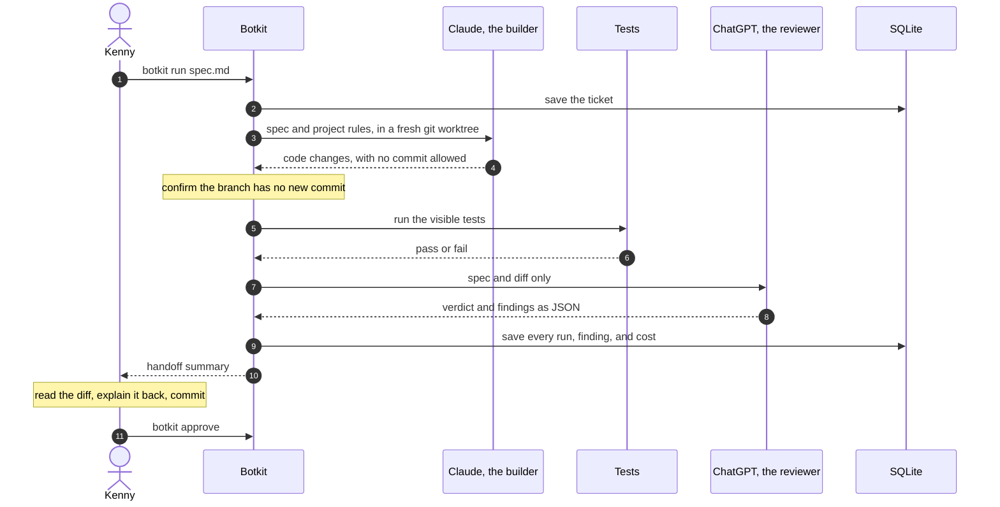
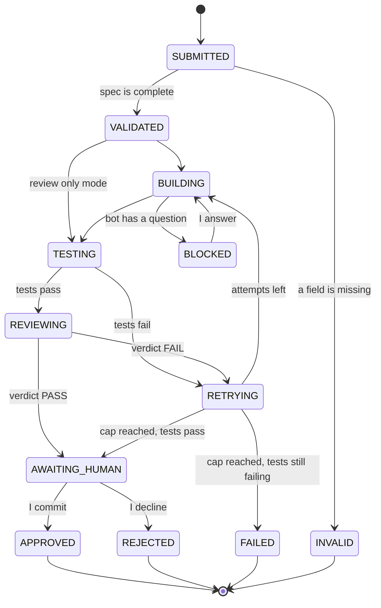
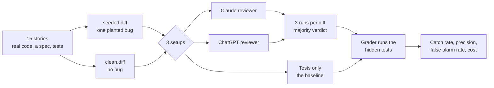
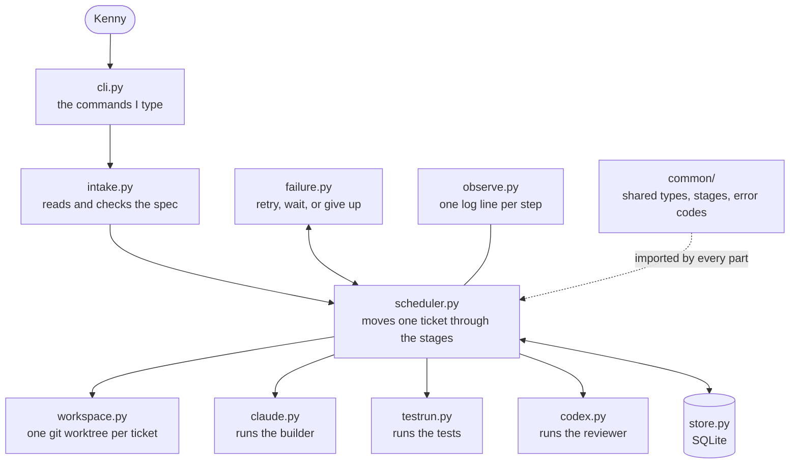

<h1 align="center">Botkit</h1>

<p align="center">
  <b>Let AI tools build software while a human stays in charge.</b><br>
  Claude builds a ticket. Tests judge it. ChatGPT reviews it. I approve and commit.<br>
  <sub>An agent harness and an evaluation harness for AI coding tools, written from scratch in Python.</sub>
</p>

<p align="center">
  <a href="https://github.com/kenecu1/botkit/actions/workflows/ci.yml"></a>
  
  
  
</p>

<p align="center">
  <a href="#the-problem">Problem</a> ·
  <a href="#what-this-project-covers">Skills</a> ·
  <a href="#how-it-works">How it works</a> ·
  <a href="#examples">Examples</a> ·
  <a href="#why-i-designed-it-this-way">Thought process</a> ·
  <a href="#the-experiment">Experiment</a> ·
  <a href="#status">Status</a> ·
  <a href="docs/design.md">Full design</a>
</p>

<p align="center">
  <picture>
    <source media="(prefers-color-scheme: dark)" srcset="docs/assets/ticket-flow-dark.svg">
    <source media="(prefers-color-scheme: light)" srcset="docs/assets/ticket-flow-light.svg">
    
  </picture>
</p>

> [!NOTE]
> **Where this stands.** The design is finished, the repo skeleton and CI are in place, and both command line tools pass their checks on my machine. The parts are being built now, so Botkit does not run end to end yet and the experiment has no results. The [status](#status) section is kept current.

## Contents

1. [The problem](#the-problem)
2. [The idea](#the-idea)
3. [What this project covers](#what-this-project-covers)
4. [How it works](#how-it-works)
5. [Examples](#examples)
6. [Why I designed it this way](#why-i-designed-it-this-way)
7. [Safety](#safety)
8. [Keeping myself in the loop](#keeping-myself-in-the-loop)
9. [The experiment](#the-experiment)
10. [Architecture](#architecture)
11. [Tools](#tools)
12. [Status](#status)
13. [Run it](#run-it)
14. [Repo map](#repo-map)
15. [Limits](#limits)

## The problem

I wanted to hand real project tasks to AI coding tools and trust what came back. Three things got in the way.

1. **One bot checking its own work is weak.** If the tool that wrote the code is also the one that says the code is fine, nothing independent ever looks at it.
2. **Tests miss things.** A change can pass every test I wrote and still be wrong. I wanted to know how much a second AI reviewer actually adds on top of tests, measured, not assumed.
3. **Automation was costing me my learning.** The more a bot did for me, the less I understood my own project. I am a student. If I cannot explain the code, the speed is not worth much.

There was also a simple trust problem. I did not want a bot to ever commit or push on my behalf.

## The idea

Botkit is a small Python orchestrator. It moves one ticket through a fixed set of stages, with a different job at each stage and a record of everything that happened.

| Stage | Who does it | What they are allowed to see and do |
|---|---|---|
| Spec | Me | I write a short spec before any code exists |
| Build | Claude Opus 5.5, through Claude Code | Works in its own git worktree. Cannot commit or push |
| Test | pytest | The judge. A failing test sends the ticket back |
| Review | A ChatGPT model, through Codex CLI | Sees the spec and the diff, nothing else. Reads only |
| Approve | Me | I read the diff, explain it back, and make the commit myself |

Botkit is also my final project for CSE 4705 (Intro to AI) at UConn. The same pipeline runs an experiment that answers one question:

> Of the bugs that slip past tests, how many does an AI reviewer catch, at what false alarm cost, and does ChatGPT catch more than Claude?

## What this project covers

Everything below is in the design today. The [status](#status) list shows which parts are built.

**AI engineering**

| Skill | Where it is in Botkit |
|---|---|
| Agent harness | The scheduler, the runners, and the limits around each bot: tools allowed, time, cost, and what it can see |
| Multi agent orchestration | A builder and a reviewer with separate roles, separate context, and a fixed handoff between them |
| Prompt engineering | Versioned prompt files for each bot. Every prompt change is logged with the failure that caused it |
| Structured output | Both reviewers must answer in one JSON Schema, and the code rejects anything else |
| LLM evaluation | A labeled dataset, blinded runs, repeated trials, and catch rate, precision, and false alarm rate |
| LLM as judge | The reviewer is the judge being tested, scored against hidden tests as ground truth |
| Guardrails | Command deny rules, a commit check after every build, a queue cap, and a cost cap |
| Prompt injection defense | Text inside a diff is treated as data, and the reviewer runs read only with no personal settings |
| Human in the loop | Every commit is mine. In a later phase, a bot that is stuck can ask me a question on my phone |
| Cost and token tracking | Tokens and dollar cost saved for every model call |

**Software engineering**

| Skill | Where it is in Botkit |
|---|---|
| Python | The whole program, standard library only, with typed dataclasses, enums, and Protocol interfaces |
| System design | Ten small parts with one job each, and shared contracts written before any part |
| State machines | Twelve ticket stages with every allowed move in one table |
| Reliability | Idempotent submits, retries with backoff, crash recovery on startup, and a dead letter table |
| SQL and data modeling | Six SQLite tables for tickets, runs, events, findings, questions, and dead letters |
| Testing | pytest, with fake bots so that no test ever calls a model or the network |
| CI | GitHub Actions runs ruff and pytest on every push and pull request |
| Git | Worktrees, branches, and diffs driven from code, and a pull request workflow |
| Process control | Running other programs with timeouts, and stopping a whole process tree on Windows |
| Observability | One log line per step, a full event history per ticket, and a status page in a later phase |
| Concurrency | Two builders in parallel through a thread pool, in a later phase |
| Command line tools | An `argparse` interface with a defined exit code for every outcome |

## How it works

### One ticket, start to finish



### The stages a ticket can be in

Every allowed move lives in one dictionary. Any other move raises an error, so a ticket can never end up in a state I did not plan for.



Four rules explain most of that diagram.

1. **Tests are the judge. The reviewer advises.** Code that passes its tests but still has an unresolved review goes to me with a flag, not to `FAILED`.
2. **Retries are capped at 2.** A retry that produces the same diff or the same failing output counts as the cap, so a stuck bot cannot loop.
3. **Crashes are separate from fixes.** A step that crashes or times out is retried up to 3 times, waiting 30, 60, then 120 seconds. After that the ticket is `FAILED` and kept for inspection.
4. **Every attempt gets a fresh reviewer.** It never sees earlier findings, so it cannot simply agree with itself.

## Examples

These show the real formats. They are written by hand to illustrate the design and are not output from a finished run.

<details open>
<summary><b>1. A ticket spec</b>, the only thing I write before a build</summary>

```markdown
# Split a markdown file on its headings

## Tier
B

## Inputs
The text of a markdown file, as one string.

## Outputs
A dictionary that maps each `## ` heading to the text under it.

## Edge cases
- A file with no headings returns an empty dictionary.
- Text before the first heading is ignored.
- A heading with nothing under it maps to an empty string.

## Visible tests
- Two headings with one line each return two entries.
- A file with no headings returns an empty dictionary.
```

A spec with a missing field is rejected before any bot runs.

</details>

<details open>
<summary><b>2. A review report</b>, the exact shape both reviewers must answer in</summary>

```json
{
  "verdict": "FAIL",
  "summary": "One high severity bug. Text under the last heading is dropped.",
  "findings": [
    {
      "file": "src/botkit/intake.py",
      "line": 41,
      "severity": "HIGH",
      "category": "BUG",
      "claim": "The section under the final heading is never saved.",
      "evidence": "A section is saved only when the loop meets the next heading. Input '## A\\nx\\n## B\\ny' returns {'A': 'x'} and loses B."
    }
  ]
}
```

The shape is enforced by [`schemas/review.json`](schemas/review.json). Each finding must name a file and a line, and its evidence must state the input and the wrong result. A reviewer that cannot do that is told to drop the finding.

</details>

<details>
<summary><b>3. How a verdict is decided</b></summary>

| The reviewer reports | Result |
|---|---|
| At least one `BUG` or `SPEC_MISMATCH` finding with severity `HIGH` | `FAIL` |
| Only `QUALITY` findings, at any severity | `PASS` |
| `FAIL` with no qualifying finding | Treated as `PASS` and logged |
| More than 5 findings | Code keeps the 5 most severe |

Zero findings is a valid review. The prompt says so directly, because a reviewer that feels it must find something will invent something.

</details>

## Why I designed it this way

I spent the design phase on decisions before writing code, so that building would mostly be filling in files. These are the choices that shaped the project and what I turned down.

| Decision | What I considered instead | Why I chose this |
|---|---|---|
| The reviewer is a different model family from the builder | Claude reviewing Claude | I wanted a second opinion that does not share the builder's habits. Whether that actually helps is an open question, and the experiment is how I find out |
| Tests judge, the reviewer only advises | Letting a review block a ticket outright | Reviewers raise false alarms. A false alarm should cost me a minute of reading, not kill working code |
| Orchestration written by hand in plain Python | An agent framework such as LangChain or LangGraph | Botkit drives two finished command line agents, not raw model APIs, so there is little for a framework to wrap. Writing the state machine, retries, and storage myself is also how I learn what those frameworks do underneath. The whole program uses the standard library, with pytest and ruff as the only dev dependencies |
| The reviewer sees only the spec and the diff | Passing it the builder's explanation too | The builder's own account could talk the reviewer into agreeing. Less context keeps the review independent |
| Bots never commit or push | Automatic merge after a passing review | I stay accountable for every line in history. A commit is my signature that I read and understood the change |
| One git worktree per ticket | Building in my main checkout | A bot cannot disturb my working files, and separate folders make parallel tickets possible later |
| SQLite for all state | JSON files, or a database server | One file, safe across crashes, and I can query history with plain SQL |
| Contracts first: one `common` module of shared types | Letting each part define its own data | Every part agrees on the shapes up front, and every test can run against fake bots with no model calls |
| A planted bug dataset with hidden tests | Judging reviews by eye | Hidden tests give ground truth that does not depend on my opinion |

The decision log with dates lives in [`DECISIONS.md`](DECISIONS.md). The complete design, including every rule quoted here, is in [`docs/design.md`](docs/design.md).

<details>
<summary><b>Ideas this project made me learn</b></summary>

- **State machine:** the stages a ticket can be in, and which stage may come next.
- **Idempotent:** safe to run twice. Submitting the same active spec twice returns the same ticket.
- **Backoff:** waiting longer before each new try.
- **Dead letter store:** a table for tickets that could not finish, kept with their last error.
- **Fake runner:** a pretend bot with scripted answers, so tests never call a real model.
- **Headless mode:** running a bot from a script with no chat window.
- **Structured output:** forcing a model to answer in a JSON Schema.
- **Context isolation:** controlling exactly what each bot can see.
- **Blinding and leakage checks:** keeping the answer away from the thing being tested.

</details>

## Safety

| Risk | Guard |
|---|---|
| A bot commits or pushes | `git commit` and `git push` are denied when the builder starts. Deny patterns can miss unusual command forms, so the real guard is a check after every build: if the branch has a new commit, the ticket stops with `SAFETY_VIOLATION` |
| The builder weakens the tests to pass | The builder may add tests but not change or delete existing ones. Any existing test file touched by the diff is flagged in the handoff |
| The reviewer is steered by text in the code | The prompt treats everything in the diff as data. Instructions found in code or comments are never followed |
| The reviewer changes files | It runs read only |
| Work piles up faster than I can read it | At most two tickets may wait for me. A third is refused with `QUEUE_FULL` |
| Runaway cost | Each build has a dollar cap and a time limit |

**Known limit.** The builder's shell access is broad, so it could touch files outside its worktree. I accept that for now on my own machine. Running the builder in a sandbox is a later hardening step.

## Keeping myself in the loop

Full automation would defeat the point of doing this as a student. Every part of the code has a tier that decides how much the bot does.

| Tier | Who writes it | What I must do | Used for |
|---|---|---|---|
| **A** | Me, by hand | Write it, then run `botkit review` so tests and the reviewer check my work | The core: shared types, the scheduler, the experiment |
| **B** | The bot | Explain every changed file back from memory before I commit | Storage, intake, worktrees, the real runners, failure handling |
| **C** | The bot | Skim and approve | Fakes, the command line, logging |

`botkit run` refuses a Tier A ticket with the message "Tier A: build by hand, then use botkit review."

## The experiment

Reviewers are tested on prepared diffs, with no builder involved, so builder randomness does not blur the result.



**The dataset.** 15 small stories, each with a buggy and a clean version of the same change, so 30 diffs. Every bug is planted on purpose and chosen so that it passes the visible tests and fails the hidden ones. Bug types: wrong boundary, missing null check, swapped argument, broken spec edge case.

**How a review is scored**

| | Reviewer says `FAIL` | Reviewer says `PASS` |
|---|---|---|
| **Seeded diff** (has a bug) | Caught | Missed |
| **Clean diff** (no bug) | False alarm | Correct |

A catch also counts as **located** when a finding names the right file within 5 lines of the bug.

**Size.** 30 diffs, 2 reviewers, 3 runs each: 180 review runs. From the same runs I also get a free combined reviewer that fails a diff if either model does.

**What keeps the result honest**

1. Every bug is written down before anything runs.
2. A check must pass first: visible tests pass on both diffs, hidden tests fail on the seeded diff and pass on the clean one.
3. Reviewers are blinded. No folder, branch, or prompt says "seeded," "clean," or "bug," and diffs run in random order.
4. Both reviewers get the same prompt and the same schema. Project instruction files and this design are removed from the review folder.
5. Logs are searched afterward. Any run where a reviewer touched the dataset folder or ran code is thrown out and rerun.
6. A pilot of 3 stories runs first to check cost and output format.
7. The result is reported even if reviewers catch little.

There are no results yet. They will be added here when the runs finish.

## Architecture



| Part | Its one job | File | Ticket | Tier |
|---|---|---|---|---|
| Common | Shared data shapes, the stage list, error codes | `common/` | BK-1 | A |
| Store | Save and read everything in SQLite | `store.py` | BK-2 | B |
| Intake | Read the spec and reject it if a field is missing | `intake.py` | BK-3 | B |
| Fakes and test runner | Pretend bots, and running test commands | `runners/fake.py`, `runners/testrun.py` | BK-4 | C |
| Scheduler | Move one ticket through the stages | `scheduler.py` | BK-5 | A |
| Workspace | One git worktree per ticket | `runners/workspace.py` | BK-6 | B |
| Real runners | Call `claude -p` and `codex exec` | `runners/claude.py`, `runners/codex.py` | BK-7 | B |
| CLI and log | The commands, and one log line per step | `cli.py`, `observe.py` | BK-8 | C |
| Failure handler | Retry, wait, or give up, and recover after a crash | `failure.py` | BK-9 | B |
| Experiment | Dataset, setups, grading, scoring | `experiment/` | BK-10 to BK-12 | A |

<details>
<summary><b>Commands</b></summary>

| Command | What it does |
|---|---|
| `botkit run <spec.md> --project <path>` | Submit and run one ticket |
| `botkit review <spec.md> --project <path>` | Review code I wrote myself. No build, only tests and the reviewer |
| `botkit status` | List tickets and their stages |
| `botkit history <id>` | Every stage change and run for one ticket |
| `botkit approve <id>` | Confirm my commit exists, mark the ticket approved, remove its worktree |
| `botkit reject <id>` | Mark the ticket rejected and remove its worktree |
| `botkit clean` | Remove worktrees of tickets that ended |
| `botkit experiment check`, `pilot`, `run`, `score` | The experiment steps |

</details>

## Tools

| Tool | Used for | Notes |
|---|---|---|
| Python 3.11 or newer | All Botkit code | Standard library only: `sqlite3`, `subprocess`, `argparse`, `tomllib`, `dataclasses` |
| pytest and ruff | Tests and lint | The only dev dependencies |
| GitHub Actions | CI | Runs ruff and pytest on every push and pull request |
| Git worktrees | One isolated folder per ticket | `git worktree add` |
| Claude Code, model Opus 5.5 | The builder, and the Claude reviewer in the experiment | Run headless with `claude -p`. Needs version 2.1.259 or newer |
| Codex CLI | The ChatGPT reviewer | Run headless with `codex exec`. `gpt-6-luna` while building, `gpt-6.1-sol` for the experiment so the reviewer matches Opus 5.5 in tier |
| SQLite | Saved state | One file |
| ntfy | Phone messages when a bot has a question | A later phase |

<details>
<summary><b>What the day 1 tool check found</b></summary>

- Both tools run headless on Windows with the flags in the design. No WSL needed.
- Claude Code returns the result, a session id, and the dollar cost of each call as JSON.
- Codex returns token counts but no dollar figure, so Botkit computes its cost from tokens.
- `gpt-6.1-sol` is not offered on my ChatGPT plan. I build with `gpt-6-luna` and will switch through an API key before the experiment, because the experiment must not compare a small model against Opus.

</details>

## Status

- [x] Full design written and reviewed ([`docs/design.md`](docs/design.md))
- [x] Repo skeleton: every module, test file, prompt, and schema stubbed
- [x] Tool check passed for Claude Code and Codex CLI
- [x] CI running ruff and pytest on every push
- [ ] BK-1 to BK-4: shared types, storage, intake, fake bots
- [ ] BK-5 to BK-6: scheduler and worktrees, running end to end with fakes
- [ ] BK-7 to BK-9: real runners, command line, failure handling. First real ticket
- [ ] BK-10 to BK-12: experiment dataset, the 180 runs, scoring
- [ ] Later: two builders in parallel, phone questions, and a live status page

## Run it

Botkit does not run end to end yet. To set up the repo and run the current checks on Windows:

```powershell
git clone https://github.com/kenecu1/botkit.git
cd botkit
py -m venv .venv
.\.venv\Scripts\Activate.ps1
pip install -e ".[dev]"
ruff check .
pytest
```

A real run will also need Claude Code (2.1.259 or newer) and the Codex CLI, both signed in.

## Repo map

| Path | What is in it |
|---|---|
| [`docs/design.md`](docs/design.md) | The full design and single source of truth |
| [`PLAN.md`](PLAN.md) | My plan in my own words |
| [`DECISIONS.md`](DECISIONS.md) | Choices I made and why |
| [`CHANGELOG.md`](CHANGELOG.md) | Prompt changes and the failure that caused each one |
| `src/botkit/` | The program |
| `agents/` | Instructions for the builder and reviewer bots |
| `templates/` | The spec template and project rules template |
| `schemas/` | The JSON Schema for a review report |
| `tests/` | One test file per module |

## Limits

I would rather state these than have a reader find them.

- The experiment's bugs are planted by me, so they may not look like the bugs a bot makes on its own. A small second set of natural bugs is collected during the build and reported as an observation, not a result.
- The sample is small: 15 stories from two code bases.
- "Same tier" for the two reviewers means the same position in each company's lineup, which is a judgment call.
- This is built and tested on one Windows machine.

---

<p align="center">
  Built by Kenny Chow · Data Science and Engineering, University of Connecticut, class of 2027<br>
  <a href="mailto:kenecu@proton.me">kenecu@proton.me</a> · <a href="https://www.linkedin.com/in/kenneth-chow2">LinkedIn</a> · <a href="https://github.com/kenecu1">GitHub</a>
</p>
