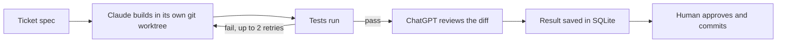

# Botkit

[](https://github.com/kenecu1/botkit/actions/workflows/ci.yml)

A small Python orchestrator that lets AI tools build software safely. Claude builds a ticket, tests run, a ChatGPT model reviews the change, everything is saved, and a human approves and commits. The bots never commit or push.

Botkit is also my final project for CSE 4705 (Intro to AI) at UConn, where it runs an experiment: **of the bugs that slip past tests, how many does an AI reviewer catch, at what false alarm cost, and does ChatGPT catch more than Claude?**

> **Status:** design finished, build in progress. The design doc and a full repo skeleton are done and the tool check on both CLIs passes. Nothing runs end to end yet. This section is updated as parts land.

## The problem

AI coding tools are fast, but one tool checking its own work shares its own blind spots. If you want to hand real tasks to bots, you need three things: a loop that catches mistakes, a record of what happened, and a human who stays in control. Botkit is that loop.

## How it works



1. **Spec first.** A ticket is a short markdown spec: inputs, outputs, edge cases, visible tests.
2. **Build.** Claude Code runs headless in an isolated git worktree on its own branch.
3. **Test.** Tests are the judge. A failing test sends the ticket back for a fix, with a retry cap.
4. **Review.** A ChatGPT model, run through the Codex CLI, sees only the spec and the diff. It advises and can flag real bugs, but it cannot overrule the tests.
5. **Record.** Every run, finding, and cost is stored in SQLite.
6. **Approve.** I read the diff and commit it myself.

## Design decisions

- **Bots never commit or push.** Enforced two ways: deny rules on `git commit` and `git push`, and a commit hash check after every build that fails the ticket if anything changed.
- **The reviewer is read only and sees as little as possible.** Spec and diff, nothing else. This keeps the review independent and the experiment fair.
- **Tests judge, the reviewer advises.** A review can only fail a ticket for a high severity bug or spec mismatch, with evidence. Style comments never fail anything.
- **Built to fail safely.** An explicit state machine, idempotent submits, retries with backoff, and a dead letter store for tickets that cannot finish.
- **A contracts first common module.** Every part imports shared types from `botkit.common` and tests against fake runners, so no test ever calls a real model.
- **Learning stays in the loop.** Files are tiered. Tier A I write by hand, Tier B the bot builds and I explain back, Tier C I skim and approve.

## The experiment

Planned and not yet run, so there are no results to report.

- **Dataset:** 15 small stories, each with a buggy and a clean version of the same change, so 30 diffs. Each bug is seeded on purpose and passes the visible tests but fails hidden tests, which serve as ground truth.
- **Three setups:** tests only, a Claude reviewer, and a ChatGPT reviewer.
- **Runs:** 3 runs per diff per reviewer, scored by majority verdict, with pooled counts reported beside it.
- **Measures:** caught, located, missed, and false alarm rate.
- **Fairness checks:** blinded labels, stripped project instructions in review worktrees, and log searches that throw out any run where a reviewer saw the answer or ran code.

Results and limits will be written up here when the runs finish.

## Build plan

| Part | What it is |
|---|---|
| BK-1 | Common module: enums, data classes, contracts |
| BK-2 | SQLite store |
| BK-3 | Ticket intake |
| BK-4 | Fake runners and test runner |
| BK-5 | Scheduler and state machine |
| BK-6 | Git worktree workspace |
| BK-7 | Claude and Codex runners |
| BK-8 | Command line interface and status output |
| BK-9 | Failure handling |
| BK-10 to 12 | Experiment dataset, setups, and scoring |

Later phases: parallel tickets with phone notifications when a bot has a question, and a live status page.

## Tech

Python 3.11 or newer, standard library first (`sqlite3`, `subprocess`, `argparse`, `tomllib`, `dataclasses`), pytest and ruff for tests and lint, git worktrees, Claude Code (Opus 5.5) as builder and one reviewer, and Codex CLI for the ChatGPT reviewer.

## Run it

Not runnable end to end yet. To set up the repo and run the current checks on Windows:

```powershell
git clone https://github.com/kenecu1/botkit.git
cd botkit
py -m venv .venv
.\.venv\Scripts\Activate.ps1
pip install -e ".[dev]"
ruff check .
pytest
```

You also need Claude Code (v2.1.259 or newer) and the Codex CLI, both signed in.

## Repo map

- `docs/design.md`: the full design and single source of truth
- `PLAN.md`: my own plan in my own words
- `DECISIONS.md`: choices I made and why
- `src/botkit/`: the program
- `agents/`: instructions for the builder and reviewer bots
- `schemas/`: JSON schema for reviewer output
- `tests/`: one test file per module

## Contact

Kenny Chow, UConn Data Science and Engineering, class of 2027. kenecu@proton.me
